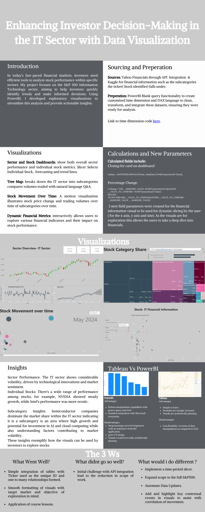
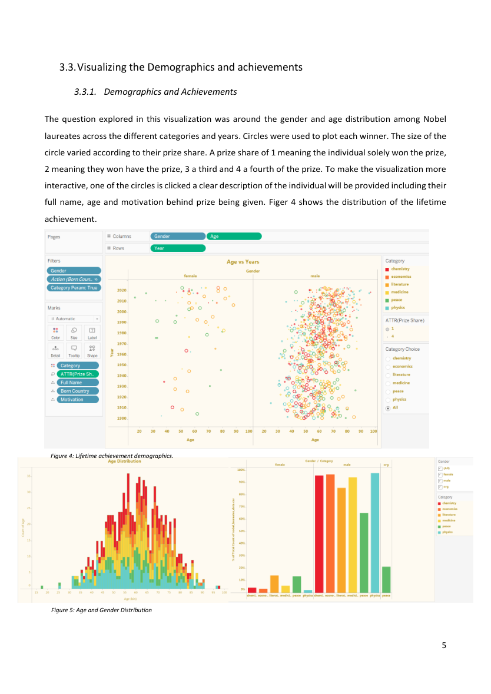

# Data Visualization: Tableau and Power BI

Two data-storytelling projects: a **Tableau** analysis of Nobel Prize laureates and a **Power BI** dashboard for S&P 500 Information Technology stocks.

## 1. Power BI: S&P 500 IT-sector stocks
**Goal:** help investors spot trends and compare stock performance within the Information Technology sector.
- Pulled historical prices from the **Yahoo Finance API** with a parameterised Power Query function, joined to financial data and sector sub-categories.
- Built a custom **time dimension** with M code, plus **DAX** measures (closing value, % change) and **field parameters** for user-driven exploration.
- Visuals: sector and single-stock dashboards with candlestick and forecast lines, a tree map of sub-categories with natural-language Q&A, an animated stock-movement scatter, and a dynamic financials explorer.
- Files: [`powerbi/`](powerbi) holds the `.pbix`, write-up, poster and source data.

## 2. Tableau: Nobel Prize recipients
**Question:** are the Nobel Prizes awarded to the top contributors to humankind's benefit? The work explores prizes by decade, country, gender, age and category, ending in a dashboard and a story.
- Files: [`tableau/`](tableau) holds the workbooks, write-up and data.

## Repository contents
| Path | What it is |
|---|---|
| `powerbi/sp500-it-stocks-dashboard.pbix` | Power BI report (data loads from the Yahoo Finance API, so refreshing may need updated links) |
| `powerbi/powerbi-writeup.pdf`, `powerbi/project-poster.pdf` | Write-up and poster |
| `powerbi/data/` | Source tables, date-table and time-dimension M code |
| `tableau/nobel-prize-winners.twbx`, `tableau/hackathon.twb` | Tableau workbooks (open with Tableau Desktop or Public) |
| `tableau/tableau-writeup.pdf`, `tableau/data/` | Write-up and Nobel datasets |

## Data sources
Yahoo Finance (stock prices); Kaggle (S&P 500 financials and sub-categories; Nobel laureate data). Datasets keep their original licences.

## Tools
Power BI (Power Query, DAX, M), Tableau, data storytelling.

## License
Original work under MIT, see [LICENSE](LICENSE).
